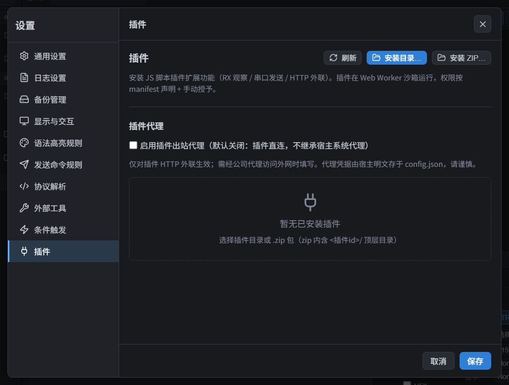

# 插件使用

HyperCom 插件是由用户安装的第三方代码。应用没有内置插件商店；安装前请确认来源、代码和权限用途。权限列表是插件声明与宿主支持能力的交集，不是安全审查或绝对沙箱保证。

本页说明普通用户的安装、授权、使用、升级和故障处理。编写插件请看[插件开发指南](../plugin-development.md)。

## 安装前要知道

- 插件代码会被复制到应用配置目录旁的 `plugins/<插件 ID>/`。直接修改源目录不会修改已安装副本。
- 多数插件在主窗口的 Worker 中运行；独立弹出窗口不运行插件。插件隔离视图当前只有 Windows 原生承载，macOS/Linux 会明确拒绝创建隔离视图，不会偷偷降级成主窗口网页。
- 插件可能访问串口数据、发送串口数据、访问网络、读写插件私有数据或使用剪贴板。只授予你理解用途的权限。
- 打开插件视图不会自动连接或断开串口，也不会自动向设备发送数据。
- 有些插件只有网页视图、没有后台 Worker；安装、启用和网页信任的流程与普通插件相同。

## 安装、授权和启用

1. 打开「设置 → 插件」；点击「安装目录…」选择包含 `manifest.json` 的插件目录，或点击「安装 ZIP…」选择插件归档。
2. 安装完成后查看权限确认。点击「授予全部并启用」立即运行；点击「稍后处理」会保留插件但不运行，之后可在插件设置中逐项授权和启用。
3. 插件安装、卸载、启用 / 禁用和权限变更会立即保存，不受设置窗口底部「取消」影响。
4. 安装后点击「刷新」可重新读取插件状态。插件按钮、端口右键菜单、插件输出面板和视图入口是否存在，取决于插件自己的 manifest 声明。

常见权限含义：

| 权限 | 用途和注意事项 |
| --- | --- |
| `ui:view` | 创建插件隔离视图、表格或工具页。 |
| `rx:bytes` | 读取原始 RX 字节；适合表格、波形和 TTY 等字节协议。 |
| `terminal:read` | 读取 TRX 终端行；TTY 没有相同的行语义。 |
| `terminal:write` | 在已打开的 TRX 终端中写入插件旁注，不会把内容发送给设备。 |
| `ui:tabs` | 让插件 Worker 打开、激活、关闭和管理自己的工作区标签。 |
| `serial:send` | 向已连接串口发送数据；还受插件声明的端口白名单限制。属于敏感权限，启用前会单独提示。 |
| `http:request` | 通过宿主发起网络请求，默认继承系统代理；插件可自行声明 URL 白名单收紧范围。属于敏感权限，启用前会单独提示。 |
| `shell:open` | 用系统默认程序打开 http、https 或 mailto 链接；不会执行本机命令。属于敏感权限，启用前会单独提示。 |
| `fs:assets` | 读取插件自带的代码与资源文件，不能修改。 |
| `fs:storage` | 读写插件自己的 `data/` 私有文件；不等于访问应用配置或任意文件。 |
| `fs:open` | 通过系统文件选择器读取你选定的外部文件。 |
| `storage` | 读写插件自己的 JSON 键值数据。 |
| `clipboard` | 读写剪贴板文本，可能接触你复制的其他内容。 |
| `notify` | 在应用内弹出插件通知；有频率和长度限制，超出会被丢弃。 |

插件读写自己的私有数据（KV 和 `data/` 文件）、发起网络请求时，应用不设统一的大小或时长上限：保存多少数据、请求多久、响应多大由插件自己决定，实际占用受磁盘空间和网络条件限制。长期使用的插件可能占用较多磁盘或流量；卸载会删除其私有数据。

## 可信网页

部分插件会声明“可信网页”，用于 AI 助手、日志分析和报告页面。首次启用会弹出确认框「信任此插件的网页？」，普通“授予全部权限”不能替代它：点「我信任此插件的网页」后才会继续启用流程，点「取消」则插件不运行。插件卡片上会显示「网页需要独立信任」或「已信任网页」。

- 信任后，网页可以连接互联网、本机和局域网服务，读取你选择的文件、使用剪贴板、导出下载并持久保存网页数据。它也可能把日志或剪贴板内容上传网络，请只信任可靠来源。
- 网页网络仍遵守浏览器跨域和证书规则；Worker 的「插件代理」设置不影响网页。模型服务连接失败时核对服务 CORS 或本地桥接配置。
- 插件的 Worker 网络默认继承系统代理；在「设置 → 插件 → 插件代理」中启用并填写地址后改用该代理。请求的时长和响应大小由插件决定，应用不设统一上限。代理凭据明文保存在 `config.json`，请只在可信环境填写。
- 网页内可在插件自带的本地页面之间跳转或刷新；你点击外部 HTTP(S) 链接时会用系统浏览器打开，不会在应用内新开窗口。
- 同一安装版本重启不重复确认；升级或替换安装保留网页数据，但必须重新确认信任。
- 「撤销网页信任并禁用」立即停止页面，保留数据。「清除网页数据」会先禁用插件，再清除 Cookie、登录状态、localStorage 和 IndexedDB；不会删除插件普通 `data/`。操作不可撤销，完成后插件保持禁用。
- 卸载也清除网页数据。应用配置导出不包含这些数据，导入不能恢复已撤销的网页信任。
- 当前仅 Windows 支持原生插件网页；可信网页也不能直接运行主窗口 Tauri 命令或任意本机程序。

## 插件入口和串口关系

插件可能提供以下入口：

- **插件输出**：插件产生输出后才会在主窗口底部出现；面板可以折叠。
- **串口内容视图**：在串口内容区上方的「显示方式」中选择插件视图。它会替换当前标签的原始终端显示，但不改变串口连接和参数。
- **独立工作区标签**：在标签栏右侧「+」中选择插件工具或视图。绑定端口的标签固定绑定打开它时的端口，不会因之后切换活动串口而重绑。
- **侧边栏按钮 / 端口右键菜单**：由插件自行声明，具体文案和行为以插件说明为准。

注意：

- 需要 `terminal:read` 的插件依赖 TRX 行数据。端口切换到 TTY 后，插件仍可能有字节输入，但不会收到同样的行回调。
- 需要 `rx:bytes` 的插件可以处理原始字节；它仍然只能从打开视图之后开始收到数据，不补发历史数据。
- 插件视图和独立插件标签不支持弹出窗口。需要弹出终端时，先切回「原始终端」；TTY 也不支持弹出。
- 关闭插件标签只关闭该插件会话，不关闭原始终端、同端口其他视图或物理串口。要停止连接，请单独断开串口。
- 选择视图、恢复工作区标签和打开工具页都不会自动连接串口。

## Sensor Workspace 示例

仓库中的 [Sensor Workspace 示例](../../examples/plugin-views-demo/README.md) 提供 Sensor table、Sensor waveform 和 Sensor settings 三个原生视图。

### 安装和权限

在「设置 → 插件 → 安装目录…」选择 `examples/plugin-views-demo`，安装后授予示例所需的 `ui:view`、`rx:bytes`、`ui:tabs` 和 `storage` 权限。

如果之前安装的是 1.0.0，重新选择当前示例目录会升级到 1.0.1。不要先卸载：升级会保留插件私有数据；卸载会删除私有数据。

### 打开 Sensor settings

- 标签栏右侧「+」选择 **Sensor settings**，无需先打开串口。
- 也可以点击插件侧边栏的 **Sensor settings**。
- 两个入口会复用同一个已打开的设置页，不应创建两个独立 Settings 页面。
- Settings 页不绑定串口，不会借用最近使用的串口，也不会发送设备命令。

### 打开 Sensor table

1. 先打开或激活具体的 COM 串口标签。
2. 点击该标签右上角「+」。
3. 选择 **Sensor table**。

表格标签会绑定当前 COM 口；串口即使尚未连接，表格也可以打开，但不会自动连接。若「+」中没有 Sensor table，请检查：当前是否为普通 COM 标签、插件是否启用、是否授予 `ui:view` 与 `rx:bytes`，以及插件视图是否支持当前端口模式。

### Sensor Workspace 的重复打开规则

同一插件、安装代次、视图、绑定端口和实例会复用已有标签。重复点击 Settings 或同一端口的 Table 入口应聚焦原页面，而不是无限创建副本。Worker 明确使用不同实例的插件可以创建多个独立会话。

## 升级、禁用、卸载和数据

### 升级

- 同一插件 ID 通常只有版本号严格更高时才允许覆盖安装；再次选择相同或更低版本时会先弹出替换确认，确认后才替换代码，取消则保留原安装。
- 升级/替换会替换插件代码和资源，但保留插件 `data/` 及网页数据。
- 升级/替换会生成新的安装身份并清除普通授权与网页信任；安装后必须重新审阅并授权。
- 「重载已安装代码」只重启当前安装的代码副本，不重新读取来源目录，也不改变安装身份、权限、网页信任或数据；适合插件自身状态卡住时使用。该按钮仅在插件已启用且 manifest 无错误时可用，成功后提示「插件代码已重载；视图将独立重新加载」。
- 升级或重载期间旧插件标签可能显示不可用占位；重载或重新打开视图后会重新加载。

### 源码修改不会自动生效

如果你从源码目录安装了插件，修改 `main.js`、`manifest.json` 或 UI 文件后不会热更新已安装副本。请递增 manifest 中的版本号，再通过「安装目录…」覆盖安装。

`npm run tauri dev` 只热更新 HyperCom 宿主源码和 Rust 开发程序，不会同步 AppData 中已安装的插件副本；「刷新」也不会重新复制插件代码。

### 禁用和卸载

- **禁用**：停止插件运行，但保留已安装代码和私有数据。
- **卸载**：删除插件代码、授权、私有数据及网页站点数据。需要保留阈值、历史或其他插件数据时，不要先卸载。
- 应用配置导出不包含插件代码和插件私有数据。备份中的插件授权只有在安装身份仍一致时才可恢复；同 ID 的升级、重装或换代码不能自动恢复授权。

## 故障处理

| 现象 | 先检查 |
| --- | --- |
| 插件不显示 | 是否安装成功、启用、刷新状态；权限是否已授予；插件是否只声明了其他入口。 |
| 插件状态卡住，想重新启动代码 | 点「重载已安装代码」；它只重启已安装副本，不重新读取来源目录。改过源码仍需递增版本号后覆盖安装。 |
| 修改源码后没有变化 | 你运行的是已安装副本；递增版本号并重新覆盖安装。不要先卸载，以免删除私有数据。 |
| 视图显示不可用 | Windows 原生视图平台限制、插件授权、安装代次、端口模式和端口是否仍存在。可点击「重试视图」或关闭占位标签。 |
| 没有 Sensor table | 激活普通 COM 标签后再点右上角「+」；确认 `ui:view`、`rx:bytes` 已授权，当前插件不是旧安装副本。 |
| 收不到插件数据 | 核对绑定端口、TRX/TTY 模式、`terminal:read` / `rx:bytes` 权限；插件从打开后的新数据开始接收，不回放历史。 |
| 插件反复崩溃或自动禁用 | 点击「刷新」，查看插件错误和「关于 → 诊断日志」；检查初始化 Promise、权限和资源声明。 |
| 设置窗口「取消」没有撤销插件操作 | 插件安装、卸载、启用 / 禁用和授权是立即持久化操作；底部「取消」只影响普通设置和代理设置。 |

不要手动删除 `plugins/`、`data/` 或事务文件来“修复”插件；这样可能破坏升级恢复并丢失私有数据。遇到持续错误时，保留插件来源、版本、安装身份和操作步骤，导出「关于 → 诊断日志」后再反馈问题。

## 相关文档

- [设置](设置.md)
- [快速入门](快速入门.md)
- [插件开发指南](../plugin-development.md)
- [插件架构（维护者）](../architecture/plugins.md)
- [隔离视图与工作区标签（维护者）](../architecture/plugin-views.md)
