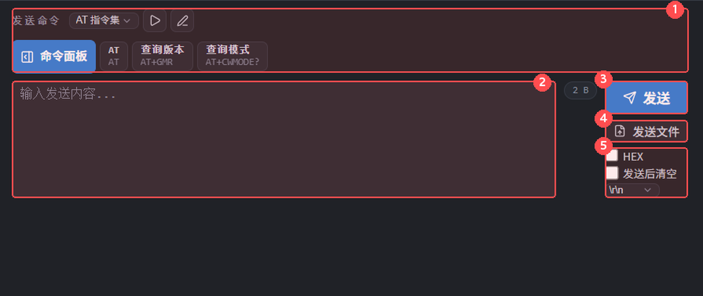
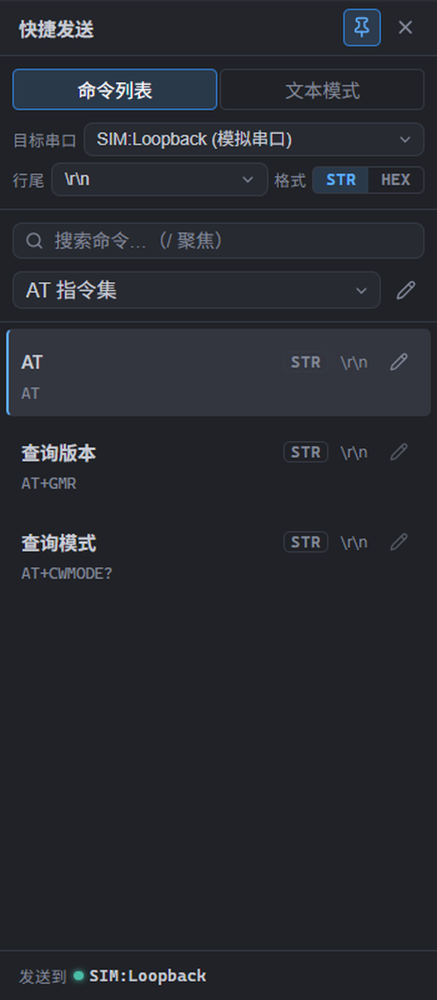

# 数据收发

本页帮助你发送一条指令、重复发送常用命令，或把文件内容发给设备。发送前先确认目标串口、串口参数和设备要求的数据格式；连接方法见 [串口管理](串口管理.md)。

## 手动发送

1. 点击要操作的串口标签页，在底部展开**操作面板**。如果尚未连接，先点击「打开串口」。
2. 在「发送命令」输入框中输入内容。发送文字时不要勾选 **HEX**；发送指定字节时勾选 **HEX**，再输入字节值。
3. 选择行尾：`\r\n`（回车加换行）、`\r`（回车）、`\n`（换行）或「无」。行尾会追加在输入内容之后；设备不需要额外结束符时选「无」。
4. 点击「发送」，或在输入框中按 `Enter`。

图中：① 命令集与快捷命令；② 输入内容；③ 发送；④ 发送文件；⑤ HEX、发送后清空与行尾。

> 未连接的串口不会发送数据，会提示「串口未连接，无法发送数据」。输入为空或只有空白时，手动发送不会执行。终端中出现 TX 行也不代表设备已经接受或执行指令，应继续查看设备的回复。

### 回车与保留输入

- 默认 `Enter` 发送；`Shift+Enter`、`Ctrl+Enter` 插入换行，用于编辑多行内容。这些换行属于发送内容，不是下方行尾选项的替代品。
- 如果希望 `Enter` 也用于换行，在「设置 → 通用设置」勾选「回车键插入换行（而非发送）」。之后在此输入框中请点击「发送」按钮发送。
- 默认发送后保留输入，便于修改或再次发送。勾选「发送后清空」后，执行发送操作会清空输入框；即使发送被拒绝或失败，也请留意输入是否已经清空。

### HEX 模式

HEX 用两个十六进制数字表示一个字节。例如 `AA BB CC` 和 `AABBCC` 都表示三个字节；大小写均可，字节之间可以有空格或换行。

- 请只输入 `0–9`、`A–F`、`a–f` 和空白，不要加 `0x` 前缀或逗号等标点。
- 主窗口输入框会去掉非十六进制字符。例如粘贴带标点的内容后，框内文字可能已经改变；**发送前检查框内实际内容**，不要把自动去掉字符当作格式校验通过。
- 去掉空白后，数字位数必须为偶数。只输入 `A` 等不完整字节时，会显示「HEX 输入无效：需为偶数个十六进制位」，「发送」按钮不可用。补全或改正后再发送；无效 HEX 不会自动补零后发送。
- HEX 模式仍会追加所选行尾。框下「末尾追加」显示对应字节，例如 `\r\n` 是 `0D 0A`；如果输入中已经包含结束符，应选「无」，避免重复追加。
- 勾选 HEX 时，现有文字会转换为 UTF-8 字节；取消勾选时，合法 HEX 会按 UTF-8 转成文字。不完整或无效 HEX 取消勾选时会保留原输入，因此切换后也应检查内容。

## 发送历史与回显

需要重发或修改上一条指令时，先点击发送输入框：

- 按 `↑` 调出最近的历史内容，继续按可向前查找；按 `↓` 返回较新的内容。调出历史时会同时恢复该条的 HEX/文字格式和行尾。
- 返回到最新记录之后再按 `↓`，输入框会清空。历史按端口分别保存，最多保留 50 条；相同内容、相同格式再次发送会更新为最近一条，而不是不断重复保存。
- 历史仅用于当前使用期间的快速重发，关闭该标签页或退出应用后不保留，不可替代 [日志记录](日志记录.md)。

在 **TRX** 模式中，终端会显示发送内容的 **TX** 行；**RX** 表示收到的设备数据。**TTY 终端**模式不额外显示本地 TX 行，文字是否回显取决于设备。收发显示方式见 [终端显示](终端显示.md)。

「设置 → 显示与交互」中的「发送提示前缀」只是在 TRX 的发送显示文字前加提示，不会把此前缀发给设备，默认留空。

## 快捷发送条 / 命令面板

### 一键发送常用命令

1. 在「发送命令」标题右侧选择**命令集**。没有命令集时，点击「配置命令集」或「编辑发送命令」图标，先创建命令；配置方法见 [规则与协议](规则与协议.md)。
2. 点击快捷发送条上的命令按钮，向当前串口发送一次。每条命令使用自身保存的格式和行尾，**不使用手动输入框的 HEX 和行尾选项**。
3. 条上的空间不够时，点击 `⋯ +数量` 或「命令面板」，在独立窗口查看全部命令。

### 命令面板（独立窗口）

点击「命令面板」或「打开独立发送面板」后，先检查顶部「目标串口」和底部「发送到」。底部指示灯绿色表示已连接，灰色表示未连接。未指定固定目标时，发送会跟随主窗口当前选中的串口；如果不希望切换标签影响目标，请在面板中明确选择串口。

面板顶部标题栏可拖动窗口；右侧图钉用于置顶，× 关闭窗口。关闭前如有未保存的命令修改，会询问「保存并关闭 / 放弃并关闭 / 继续编辑」。

**命令列表**适合发送已经保存的命令：

1. 选择命令集，可用搜索框查找命令。
2. 点击一条已保存命令立即发送，格式和行尾以该条命令为准，而不是面板顶部的选项。
3. 点击「修改」就地编辑名称、内容、延时、顺序、STR/HEX 和行尾；通过左侧手柄拖动排序，或点击「在上方插入」「在下方插入」添加。编辑中的命令集暂不允许点击发送。
4. 修改先进入草稿：顶部显示「未保存的更改 / 正在保存… / 已保存」，命令集下拉框中带 `*` 表示仍有未保存内容。点「保存」并等状态变为「已保存」后，主窗口快捷发送条和新启动的循环才会使用新内容；点「放弃更改」可撤销本次草稿。切换命令集、切到文本模式再回来，草稿仍在。
5. 搜索框有内容时不能拖动排序，需要先清空搜索。
6. 展开列表中的「编辑命令集」可直接新增、删除、排序命令集，并在下方修改名称与循环参数；点击命令集下拉框右侧的铅笔图标，则在主窗口打开完整的「发送命令规则」设置页。

> 如果面板编辑期间又在主窗口「设置 → 发送命令规则」中改了同一命令集，面板里的旧草稿会失效并提示「配置已在其他位置更改。草稿已保留，请放弃更改后重新编辑。」。在面板点「放弃更改」，再按主窗口设置页的内容继续编辑即可。

**文本模式**适合临时逐行执行一组指令：

1. 每行输入一条命令；空行会跳过。这里按 `Enter` 是编辑换行，不会直接发送。
2. 设置顶部「格式」（STR 为文字，HEX 为十六进制字节）和「行尾」，它们用于文本区中的每条命令。设置「发送间隔 (ms)」控制行与行之间的等待时间；循环时用「轮次间隔 (ms)」控制末行到下一轮首行之间的等待时间。
3. 把光标放在需要执行的行，再选择执行方式。图标含义可将鼠标停留其上查看：

| 操作 | 效果 |
| --- | --- |
| 执行当前行 | 只发送光标所在行 |
| 执行当前行并移至下一行 | 发送当前行后将光标移到下一行，便于连续单步操作 |
| 顺序完整执行 | 从第一行执行到末行，执行一遍后结束 |
| 从当前位置执行 | 从光标所在行执行到末行，执行一遍后结束 |
| 完整循环执行 | 从第一行开始，执行到末行后再次从头执行 |
| 停止 | 停止后续执行；已经发出的数据不会撤回 |

> 文本模式的 HEX 行必须只含十六进制数字和空白，且数字位数为偶数。批量执行会跳过无效 HEX 行，并在停止或执行结束时提示；全部行都无效时不会启动。运行中修改文本、切换到命令列表或关闭面板会停止执行。需要调整指令时，建议先点「停止」再编辑。

## 循环发送

要按命令集的设定重复发送：

1. 在主窗口选中目标串口并连接，选择一个含命令的命令集。
2. 点击标题右侧「编辑发送命令」图标，检查命令的**延时**、命令集的**两轮间隔**、「循环」和「重复」轮数。
   - 「重复」大于 0：发送指定轮数后自动停止，优先于「循环」勾选状态。
   - 「重复」为 0：勾选「循环」则持续发送，不勾选则只执行一轮。
3. 点击「开始循环」图标启动，需提前结束时点击「停止发送」。

循环固定启动时的串口、已保存命令集、顺序和循环参数，切标签或修改配置不会中途改发。多串口可分别运行，停止按钮只停止当前选中串口的循环。新版本保存后需停止并重新启动循环才会采用；拖动排序不会使当前运行重复或跳过某条命令。

> 串口临时断开时，主窗口循环会等待连接恢复，然后继续发送，不会自动取消任务。若不希望重连后继续，请切回该串口点击「停止发送」。另一种临时循环方式是命令面板的「文本模式 → 完整循环执行」，其间隔在面板顶部设置，停止也在该面板中操作。

## 发送文件

1. 确认当前串口已连接，并确认设备能够接收文件原始字节。
2. 点击「发送文件」，选择文件。文件按原始内容发送，不受输入框的 HEX 和行尾选项影响；当前文件大小上限为 100 MB。
3. 查看发送进度；需要中断时点击「取消发送」。取消会停止后续数据，但不能撤回已经发出的部分。
4. 非空文件全部发送完成后会提示「文件已发送」，进度条消失。取消、空文件不会显示成功提示；发生错误时查看错误通知。

> 「文件已发送」仅说明文件数据已发送完，不代表设备已校验、保存或安装成功。**发送文件不是通用的固件烧录功能**，也不会自动执行设备要求的传输协议。请按设备说明选择功能。文件内容不会作为一条命令加入发送历史，也不会完整显示为 TX 行；自动日志仅记录文件发送的分块信息，不能用它还原所发文件。

## 相关

- [串口管理](串口管理.md)
- [终端显示](终端显示.md)
- [规则与协议](规则与协议.md)
