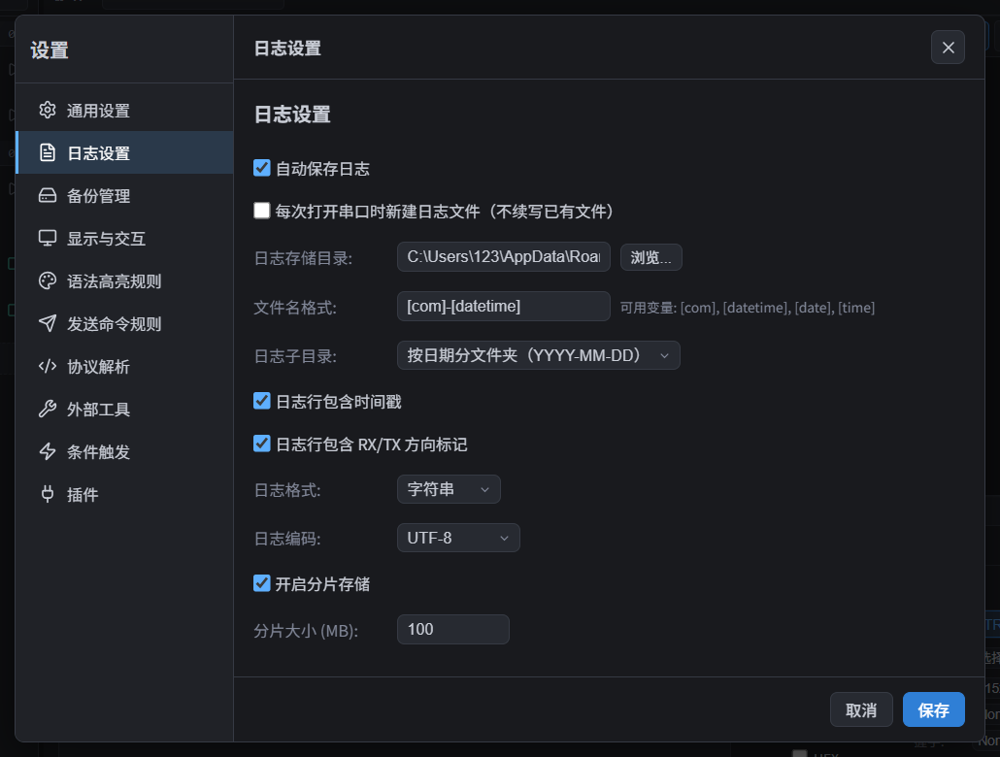

# 日志记录

需要留存设备输出、排查一次收发过程，或把结果发给别人时，可以保存日志。本页区分三种操作：**自动日志**保存串口收发记录，**回放日志**把旧记录显示到终端，**导出终端内容**保存终端当前仍保留的记录。

## 自动落盘

1. 打开「设置 → 日志设置」，确认「自动保存日志」已勾选，默认开启。
2. 连接目标串口。连接期间的接收数据和普通指令发送会自动记录，不需要另点录制按钮。
3. 在底部**操作面板**顶部点击「目录」图标，找到保存的文件；默认按日期分文件夹存放。

> 首次使用没有选择目录时，应用会使用系统用户数据目录下的 `hypercom/logs`。设置框里未显示自选路径不代表没有记录，点击「目录」即可打开实际位置。若在连接之后才开启自动保存，建议断开并重新连接，确保本次记录已开始。

- **RX** 表示接收，**TX** 表示发送。默认日志带时间戳和方向标记，例如 `[2026-09-29 10:20:30.123] RX 设备就绪`。
- 日志不等于终端截图：终端的清屏、显示筛选等操作不会改写已经保存的自动日志。
- 接收内容尚未形成完整一行时，日志中可能暂时看不到末尾部分；需要保存完整过程时，建议结束操作后先断开串口，再取日志。断开时会保存剩余接收内容，无内容的空日志文件会删除。
- 发送文件时，日志只记录各部分发送的序号和字节数，不保存整个文件内容，不能从日志还原所发文件；见 [数据收发](数据收发.md)。

## 操作面板里的日志操作

先选中目标串口标签页，展开底部**操作面板**。日志按钮在面板顶部一排；将鼠标停在图标上可查看名称。

| 按钮 | 什么时候用 | 保存或打开的内容 |
| --- | --- | --- |
| 另存为 | 把日志副本保存到桌面、U 盘等位置 | 正在记录的日志文件；已断开时使用找到的该端口最新日志文件。保持原文件内容和格式，不会转成 TXT，也不会合并多个分片 |
| 打开文件 | 用系统关联的程序查看日志 | 在日志目录中找到的该端口最新日志文件；找不到时提示「未找到该端口的日志文件」 |
| 目录 | 找到历史记录或收集完整的分片 | 打开当前日志存储目录，可自行选择需要的文件 |

> 「另存为」不是重新开始记录，也不是导出全部历史。如果本次过程跨了多个文件，请用「目录」找到并收集相关分片，不要只保存最后一个文件。

## 回放日志

回放用于查看旧记录，**不会把日志中的 TX 内容再次发送给设备**。

1. 点击操作面板顶部的「导入历史日志」，不需要先打开或连接任何真实串口。
2. 在原生文件选择器中多选日志，在导入面板确认每个文件所属轨道、分片顺序、文本/HEX 格式和记录机 UTC 偏移。不会按同名端口自动合并文件。
3. 确认来源后导入，历史以独立的**只读回放标签**打开；不会追加到实时终端，也不触发自动回复、告警或插件实时输入。
4. 使用回放工具条播放/暂停、调倍速、跳起点或终点；完整历史已经载入，可以直接搜索。多轨时间组共用一个时钟，保留真实长时间停顿，不再把长间隔截成 1 秒。
5. 手动导航会暂停播放，继续需显式点击播放。要把不同设备或不同采集日期对齐，使用[时间联动](时间联动.md)设置事件基准或常量偏移。

首版预算：UTF-8 文本/HEX 文本，最多 16 文件、每文件 32 MiB、总文件 64 MiB、500,000 记录及 192 MiB 解码内存。超过预算明确拒绝，不截断历史。恢复工作区时只恢复来源描述，不自动读文件或播放；需重新选择原始文件，校验内容并授权。

### 哪些文件适合回放

- 建议保留**完整日期时间**和 **RX/TX 方向标记**，例如 `[2026-10-30 10:20:30.123] RX 内容`。日志未带时区时，导入前必须确认记录机 UTC 偏移；不要把文件创建时间或文件名当作事件时间。
- 不含可靠时间的记录仍保留原始顺序，时间显示 `—`，不会伪造为 1970 或当前时间。全无时间的轨道可以独立查看，但不参加真实时间联动。
- 导入时可明确选择 HEX 文本。原始 binary 与 GBK 不在首版导入支持范围，不能从 binary 日志自动恢复帧边界。
- 检测到时钟回拨时，请先选择明确时段再参与联动；不会偷偷重排文件记录。
- TXT 导出若使用相对时间或省略时间戳，可能只能独立查看。CSV 不在当前导入格式承诺内。

## 日志设置（设置 → 日志设置）

以下默认值指首次使用；已保存的设置以你当前看到的选项为准。

| 设置项 | 怎么选择 | 默认值 |
| --- | --- | --- |
| 自动保存日志 | 需要保留收发过程时勾选；取消后不再记录新的收发数据，已有文件保留 | 开启 |
| 每次打开串口时新建日志文件（不续写已有文件） | 希望每次连接的记录分开时勾选；不勾选时，只有文件名和所在子目录相同时才会续写，并非总是接着上一文件写 | 关闭 |
| 日志存储目录 | 点击「浏览...」选择保存位置；「目录」按钮可打开实际存储位置 | 系统用户数据目录下的 `hypercom/logs` |
| 文件名格式 | 用 `[com]` 表示端口号，`[datetime]` 表示日期时间，`[date]` 表示日期，`[time]` 表示时间；建议保留 `[com]`，便于区分端口 | `[com]-[datetime]` |
| 日志子目录 | 可直接存入日志目录，也可按日期或串口号分文件夹 | 按日期分文件夹（`YYYY-MM-DD`） |
| 日志行包含时间戳 | 需要知道收发时间或回放日志时保留勾选 | 开启 |
| 日志行包含 RX/TX 方向标记 | 需要区分设备输出与发送指令、或回放日志时保留勾选 | 开启 |
| 日志格式 | 「字符串」适合阅读文字；「十六进制」适合检查字节值；「二进制」保留数据字节，也可能带所选时间戳、方向及分行符，不能当作完全无附加内容的原始文件 | 字符串 |
| 日志编码 | 字符串日志出现乱码时，按设备文字编码选择 ASCII、UTF-8、GBK 或 ISO-8859-1；它不替代终端的显示编码选项 | UTF-8 |
| 开启分片存储 | 长期或大量记录时保留勾选，避免单个文件持续增大 | 开启 |
| 分片大小 (MB) | 开启分片后出现；单个文件达到此大小后继续记录到新文件，可设 1–10240 MB | 100 MB |

> 日志编码、时间戳和方向开关等不会把已打开文件的旧内容重新转换。调整后建议断开并重新连接，让新记录使用新设置；要避免不同设置的记录续写到同一文件，可同时开启「每次打开串口时新建日志文件」。

### 更改保存目录

点击「浏览...」选择新目录。已有自选目录时会出现「更改日志目录」确认框：

- **仅切换目录**：之后使用新目录，旧文件仍留在原目录。
- **迁移旧日志并切换**：把旧日志移到新目录，再使用新目录。
- **取消**：保留原目录。

首次选择自定义目录时不出现这份确认框；原来默认目录中的记录不会自动搬走。迁移或整理重要记录前，建议先断开串口并备份所需文件。

## 日志分片

开启分片后，记录达到设定大小就换一个新文件继续写。新文件按文件名格式生成；如果同名文件已存在，会加 `-1`、`-2` 等后缀。由于文件名可能包含当前时间，分片不一定都只是原名加序号。

需要一段完整过程时，请在日志目录中按端口和时间找到相关文件。「另存为」不会自动拼接分片；回放可以多选文件，并在导入确认中手动指定同一轨道及分片顺序。

## 导出终端内容

如果只想保存终端当前仍保留的记录，而不是取自动日志文件：

1. 在 **TRX** 终端内容区点击右键。
2. 选择「导出为 TXT」或「导出为 CSV」，再选择保存位置。
   - **TXT**：以文字行保存，包含时间、方向和内容，便于阅读。
   - **CSV**：以时间、方向、内容三列保存，便于表格软件分析。

导出包含终端仍保留的全部行，不限于当前屏幕可见行或选中行。清屏前的记录、超过保留行数而移出的旧记录不在导出中；如需长期完整记录，应使用自动日志。导出的时间表示会使用终端当前的时间格式和时间戳模式，不是自动日志设置中的格式。

## 相关

- [数据收发](数据收发.md)
- [终端显示](终端显示.md)
- [设置](设置.md)
