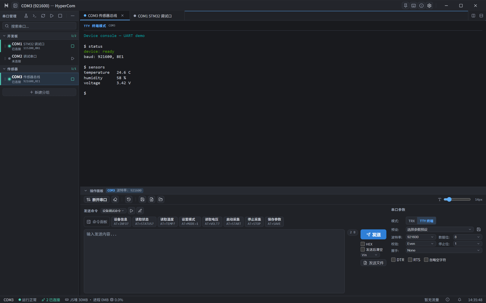
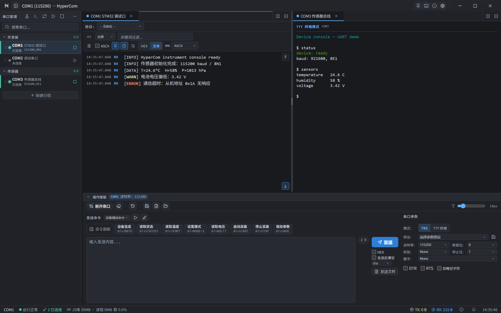
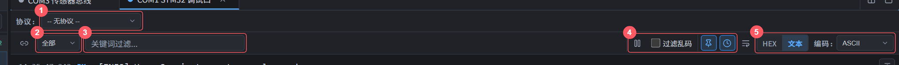
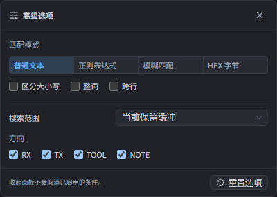

# 终端显示：看数据、搜索和分屏

中间的终端显示当前标签页的数据。默认会跟着最新内容滚动；如果你想查看旧内容，可以暂停显示、锁定滚动位置或搜索关键词。

## 先选对终端模式

在下方「串口参数」里的「模式」选择：

| 模式 | 适合什么情况 | 主要特点 |
| --- | --- | --- |
| **TRX** | 普通串口调试、查看日志和收发报文 | 按行显示，可筛选 TX/RX、搜索、改编码和显示格式 |
| **TTY 终端** | 与设备命令行交互，例如 shell、`vim`、`top` | 像电脑终端一样处理光标和控制效果，不按行过滤 |

TTY 模式按 UTF-8 显示字节流，不提供 TRX 的编码切换、关键词筛选和协议解析。发送时也不会再把内容在本地显示一遍，设备自己回显时不会出现重复文字。TTY 标签在同一分屏内切换或拖到另一个分屏都不会销毁会话；关闭标签或改模式时，当前显示会话会被释放。TTY 目前不能弹出到独立窗口。

上图是 TTY 模式：光标、颜色和全屏程序按原始终端流显示。切回 TRX 使用下方「串口参数 → 模式」。

## 标签页和分屏

- **打开标签页**：双击左侧端口，或右键端口 →「在标签页中打开」。
- **切换标签页**：点击标签标题。活动标签决定下方操作面板控制哪个端口。
- **关闭标签页**：点击标签上的 ×，或右键标签选择「关闭」。关闭标签页**不会断开串口**，也不会停止后端日志；重新打开后从新的显示起点开始。
- **整理标签页**：拖动标签改变顺序，或拖到其他分屏。
- **分屏**：点击标签栏右侧的左右 / 上下分屏按钮；拖动中间的分隔条调整大小。空分屏可点击「关闭分屏」。
- **批量连接**：标签右键菜单里的「打开所有标签页」和「断开所有标签页」会处理所有标签页对应的端口。

分屏后每个区域保留自己的标签和终端；下方操作面板控制当前焦点所在分屏的活动标签。

### 弹出到独立窗口

- 右键普通串口标签，选择「弹出到独立窗口」，可把该端口的终端放到单独窗口显示。
- 独立窗口顶部标题栏可拖动移动窗口；右上角图钉可置顶，× 关闭窗口。关闭窗口不会断开串口，也不会停止自动日志。
- 独立窗口只显示接收（RX）数据，不显示 TX，也不做协议解析；顶部提示「仅 RX」和「协议: -- 无协议 --」。
- 独立窗口打开期间，主窗口不再显示该端口的内容；若该分屏内没有其它可显示的标签，内容区会提示「已弹出到独立窗口」，可点「收回」结束独立窗口。关闭独立窗口（或点「收回」）后，主窗口对应的标签会自动恢复显示。
- 插件视图和插件标签没有弹出入口；TTY 标签选择弹出时会提示「TTY 模式暂不支持弹出窗」，需先切回 TRX。

## TRX 工具栏

图中：① 协议模板；② 全部 / 仅 TX / 仅 RX；③ 关键词过滤；④ 暂停、滚动锁定、时间戳；⑤ 文本 / HEX 与编码。

终端上方的工具栏提供这些操作：

| 控件 | 用途 |
| --- | --- |
| **全部 / 仅 TX / 仅 RX** | 只看全部数据、电脑发出的数据或设备发来的数据 |
| **关键词过滤** | 只保留包含关键词的行；右侧显示匹配行数 |
| **过滤乱码** | 面向 ASCII 英文日志，隐藏大片不可读字节及其中零星可读字符所在的行；默认关闭，仅文本视图生效 |
| **暂停** | 暂停画面更新，但数据仍会在后台接收；点播放按钮恢复显示 |
| **图钉（滚动锁定）** | 开关自动跟随；点亮时持续跟着最新数据，关闭后可阅读旧内容 |
| **时间戳** | 显示或隐藏每行时间 |
| **自动换行** | 长文本按当前终端宽度折行，默认关闭；仅文本模式可用 |
| **文本 / HEX** | 在可读文字和十六进制字节之间切换显示 |
| **编码** | 选择 UTF-8、GBK、ASCII 或 ISO-8859-1；切换后旧内容会按新编码重新显示 |
| **协议** | 选择已配置的协议模板（只在 TRX 模式使用） |

如果终端内容变成乱码，先检查下方串口参数，再尝试切换「编码」。切换编码只改变显示方式，不会重新发送数据。

### 长文本自动换行

工具栏的 **「自动换行」** 按钮可让长文本按当前终端宽度折行，不必反复拖横向滚动条。默认关闭，每个端口独立设置；断开重连保留，关闭标签后恢复默认，不保存为下次启动的偏好。普通终端、独立终端窗口和只读回放共用这项显示能力，TTY 不受影响。

- 仅文本模式生效；切到 HEX 时暂时禁用，切回文本恢复原开关状态。
- 时间戳和 RX/TX 标记只在记录开头显示，续行沿正文区域排列。
- 只改变排版，不插入真实换行；缓冲行数、搜索匹配行数、复制与导出仍按原记录解释。
- 大量历史内容采用按需排版，滚动条长度可能随未访问记录的测量而修正；极长单条记录或频繁拖动分屏时，排版成本仍可能增加。高速接收时可随时关闭，恢复原来的单行显示路径。

### 同一串口混合英文日志与二进制协议

在 TRX 工具栏勾选 **「过滤乱码」**，会按原始字节判断接收行，整行隐藏以不可读内容为主的行，里面零星的字母、数字也一起隐藏；较长连续英文片段优先保留，不逐字符拼接出可能误导的“日志”。工具栏会显示当前匹配行数。

- 每个串口独立设置；主窗和弹出窗独立设置，默认关闭，不保存为下次启动的偏好。
- 切到 HEX 时暂时显示全部行，切回文本继续过滤；取消勾选可恢复缓冲区里尚未淘汰的行。
- 只影响接收内容的显示与搜索，不影响发送回显、实际接收、流量统计、触发器、插件或后端日志。右键「复制全部」和 TXT/CSV 导出仍包含被隐藏的缓冲内容。
- 这是启发式筛选，不是协议解析。中文等非 ASCII 日志可能被误隐藏；短的乱码碎片、全为可打印字符的协议片段可能漏过。日志与协议夹在同一行且有较长英文时，整行保守保留。

## 滚动、暂停和跳转

- 默认在底部跟随新数据。
- 点顶部的「滚动到顶部」会跳到最早内容并取消跟随；点「滚动到底部」会回到最新内容并恢复跟随。
- 手动滚轮、拖动滚动条或使用方向键查看旧内容后，HyperCom 会在操作结束时根据当前位置决定是否继续跟随。
- 「暂停」与滚动锁定不同：暂停只停止画面更新，数据仍然接收；滚动锁定只控制是否跟着底部走。
- 在终端上按 `Ctrl`（macOS 为 `Cmd`）并滚动，可调整终端字号。

## 在当前终端搜索

1. 点击终端后按 `Ctrl+F` 打开当前终端的搜索栏。
2. 输入关键词，默认按普通文本搜索；需要其他条件时再打开「高级选项」。
3. 按 `Enter` 跳到下一个结果，按 `Shift+Enter` 跳到上一个结果；也可以点击上下箭头。
4. 按 `Esc` 或点击 × 关闭搜索。

一级搜索栏从左到右是：搜索输入框、匹配计数、上一个 / 下一个、「高级选项」和关闭。高级控件默认不展开，不常驻占用终端高度。快捷键见 [键盘快捷键](快捷键.md)。

搜索不会删除数据。打开、输入或关闭搜索框不改变图钉状态：图钉亮着时仍跟随最新数据，便于实时观察关键词高亮。跳到某个搜索结果会先关闭跟随，避免刚定位又被新数据拉回底部；关闭搜索也不会自动恢复跟随。想继续看最新内容，可在搜索框保持打开时直接点亮图钉。

### 高级搜索：跨行、模糊、正则与 HEX

点击搜索框右侧的 **「高级选项」** 打开二级浮层，再选择 **普通文本 / 正则表达式 / 模糊匹配 / HEX 字节**，以及大小写、跨行、整词、方向和搜索范围。浮层不会推挤终端内容。

高级条件启用后，入口显示数量标记；收起面板不会取消条件。「重置选项」恢复普通文本默认设置，但不清空查询内容。按 `Esc` 先关闭高级浮层并回到入口，再按一次才关闭搜索；也可以点击浮层外部回到搜索。

- **跨行**：勾选后可在输入框直接输入换行；`Enter` 插入换行，`Ctrl/Cmd+Enter` 跳到下一个结果，加 `Shift` 反向；`F3 / Shift+F3` 仍可导航。最多匹配 32 条真实相邻记录、16 KB 文本，不受视觉自动换行影响。被过滤或排除的中间记录会切断匹配，不会把不相邻记录拼起来。
- **模糊匹配**：查询字符按顺序出现即可，中间可间隔其他字符；例如 `err` 可匹配 `ERROR`（不区分大小写时）。这不是错别字纠正，查询字符仍须依次存在。模糊命中的字符会被高亮。
- **正则表达式**：支持行内和跨行表达式；非法或被安全策略拒绝的模式显示错误。较慢任务在后台搜索 Worker 中运行，可以取消，不退回主线程执行。
- **HEX 字节**：支持 `AA BB CC` 和 `AABBCC`，直接匹配原字节。必须是完整偶数位，不允许非法字符；只在单条记录内匹配，不跨记录拼接字节。
- **当前保留缓冲 / 当前过滤结果**：前者搜索仍在本终端缓冲中的记录，后者仅搜索通过当前显示过滤的记录；暂停时只搜索暂停上界以内的数据。

高级搜索采用分批计算，可能先显示“正在搜索”或部分结果。计数按命中结果，而非视觉折行数；跨行搜索对同一起始记录保留最先完成的最短命中窗口。最多保留 10000 个结果和有限的高亮片段；高级搜索会跳过超长记录，模糊单条文本预算为 8 KiB，其他高级文本为 16 KiB（按 UTF-16 估算）。命中上限、超长记录或高速接收造成的缓冲淘汰会显示结果不完整的提示。关闭搜索后取消计算并释放临时结果，不在后台建立持续索引。原有普通单行文本搜索继续使用增量快速路径。

选择“当前保留缓冲”时，结果可能位于显示过滤范围之外。显式跳转会暂时展示全部保留缓冲，并显示“恢复过滤”按钮；不修改原过滤条件，关闭/修改搜索或调整过滤也可恢复。HEX 字节搜索在全缓冲范围内不受文本专用乱码过滤限制，定位时切换为 HEX 显示。

### 多端口全局搜索

点击**标题栏右侧的放大镜图标（全局搜索）**，或按 `Ctrl/Cmd+Shift+F` 打开全局面板。默认可直接输入查询搜索全部已打开的 TRX / 只读回放来源，一级界面只显示选中来源数；需要选择端口、跨行、模糊或其他条件时，点击搜索框旁的 **「高级选项」**。本地和全局搜索共用相同的二级面板。结果分批到达，按页显示，排序位于结果区底部；点击结果会激活对应标签并定位到命中记录，搜索定位仍会停止自动跟随。

全局搜索仅覆盖**当前窗口、已打开的来源仍保留在内存中的记录**，不包含 TTY、日志文件、完整连接历史、独立弹出窗口中的缓冲或已被淘汰的数据。结果被清屏、关闭标签、编码变化或缓冲淘汰影响后可能过期，此时不会跳到错误的新记录。

## 复制、转换和导出

在终端内右键可以：

- 复制选中的内容、当前可见内容或全部内容；
- 全选；
- 把选中内容复制为 HEX，或把 HEX 转成文本；
- 导出当前终端内容为 TXT 或 CSV。

TXT / CSV 导出会先弹出保存位置选择框。导出的是当前标签页保留的内容，不等同于连接期间自动保存的完整日志；完整日志请看 [日志记录](日志记录.md)。
