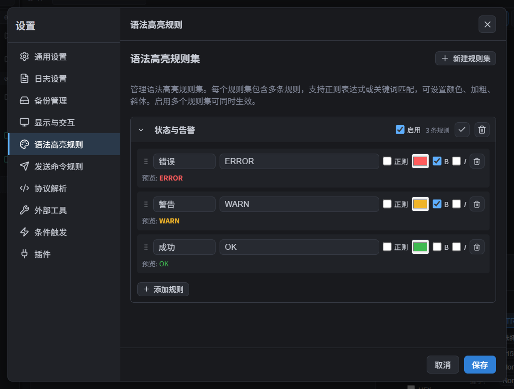
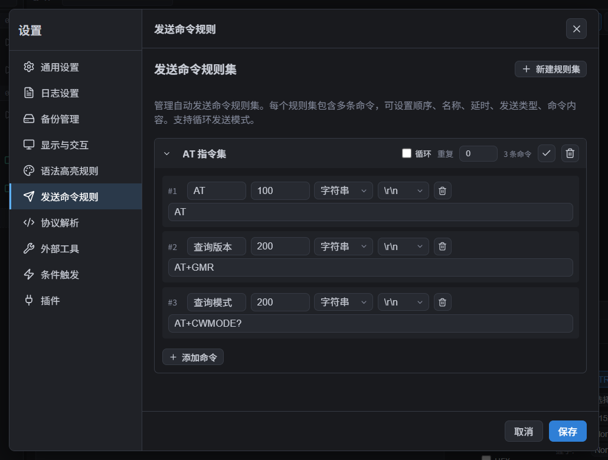
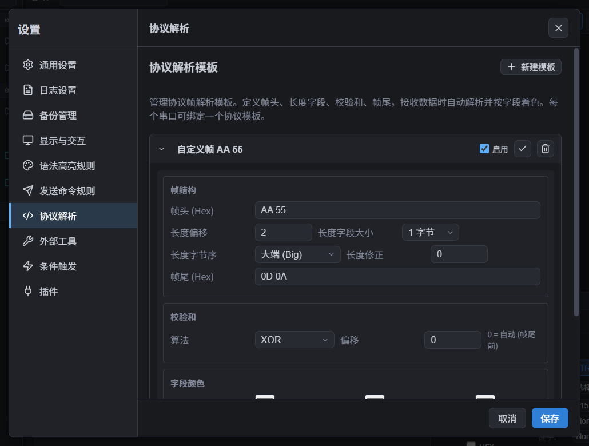
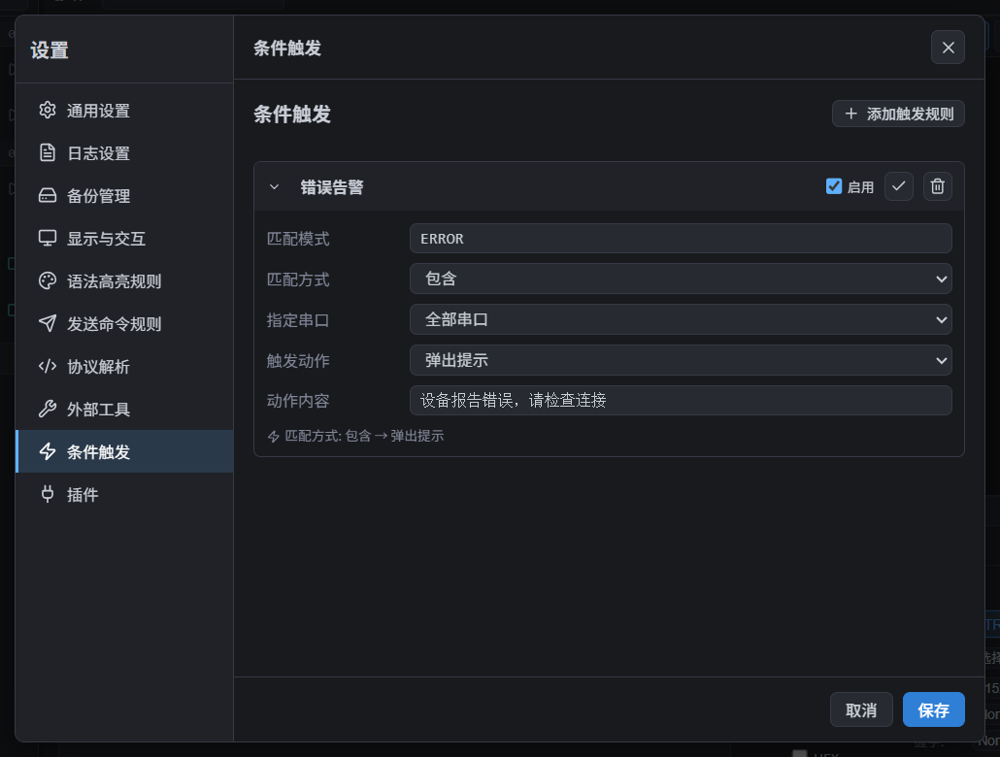
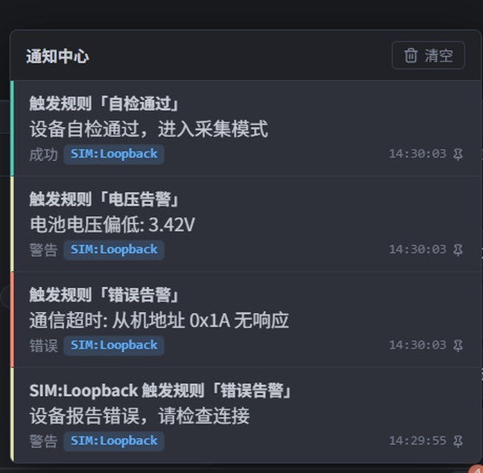

# 规则与协议

这几项功能都在「设置」窗口中配置：**语法高亮**帮助你快速看出重点，**发送命令集**帮助你重复发送，**协议解析**按帧结构显示数据，**条件触发**在收到特定内容时提醒或回复。

所有规则采用相同的[草稿与保存规则](设置.md)：切页保留，保存后生效，关闭时提示。页面顶部显示「未保存的更改 / 已保存」，可用「保存」「放弃更改」提交或撤销整页草稿；每个规则集、命令集、模板行末的保存图标只保存该行。规则集、命令集、协议模板、外部工具和提醒规则的管理列表支持手柄拖排序及上下插入；命令和高亮规则的内部列表也支持这些操作。删除在保存前可以放弃恢复。名称为空、正则无效或 HEX 不是完整字节时，保存会提示错误并保留草稿。

## 语法高亮规则

打开「设置 → 语法高亮规则」。

- 点击「新建规则集」，再点击「添加规则」。每条规则可填写名称、匹配内容，并选择按关键词或正则表达式匹配。
- 可设置颜色、粗体和斜体；规则集保存并启用后才参与终端高亮，多个规则集可以同时启用。
- 相同起点优先较长匹配；起点和长度都相同时，靠前的规则集及规则优先。排序不是“只使用第一条命中规则”。

## 发送命令规则集

打开「设置 → 发送命令规则」。

- 新建命令集，为命令填写名称、延时、文本或 HEX 格式、内容和行尾；拖动手柄决定发送顺序，或用上下插入直接添加到目标位置。命令延时用于该条发送完成后到下一条的等待，最后一条到下一轮使用轮间隔。
- 勾选「循环」可重复发送；可设置每轮间隔。将「重复轮数」设为大于 0 时，发送指定轮数后停止；设为 0 时按「循环」开关决定发送一轮还是持续循环。
- 保存后，编辑页、命令面板、快捷发送条和新启动循环使用同一顺序。运行中的循环固定启动快照，修改、保存、切换或删除命令集都不会中途改变它；停止重启后使用新版本。
- 发送时在主窗口操作面板选择命令集，再点击命令或循环按钮。也可打开[数据收发](数据收发.md)中介绍的快捷发送条或命令面板。

## 协议解析模板

打开「设置 → 协议解析」，新建模板并勾选启用。模板可填写：

- **帧头（HEX）**和**帧尾（HEX）**，例如 `AA BB`、`0D 0A`；没有帧头或帧尾时留空。
- **长度字段**的位置、大小（1 或 2 字节）、字节序（小端或大端）和长度修正值。
- **校验和**算法（无、Sum8、XOR 或 CRC-8）及校验和位置；位置为 0 时由程序按帧尾前的位置处理。
- 帧头、长度、负载、校验和、帧尾各部分的显示颜色。

保存模板后，在对应串口终端工具栏的「协议」下拉框中选择已启用的模板。之后收到的数据会按帧解析并按字段着色；选择「无」可关闭解析。协议解析只适用于 **TRX** 模式，TTY 终端按原始终端流显示，不做协议解析。

> 弹出的独立终端窗口只显示接收流，不会重新进行协议帧解析；主窗口中已经解析好的内容仍可按字段显示。

## 条件触发

打开「设置 → 条件触发」，点击「新建规则」。选择匹配方式并填写内容：

- **包含**：收到的完整行中包含指定文字。
- **精确匹配**：完整行与指定文字相同。
- **正则表达式**：按正则规则匹配。
- **HEX 字节**：按收到的原始字节匹配。

然后选择动作：

- **弹出提示**：在通知中心显示规则中填写的提示内容，并标明来源串口和规则。
- **自动回复**：向来源串口发送动作内容；需要发送字节时勾选 HEX 格式。

「指定串口」留空适用于所有串口。条件触发按完整行判断，TTY 不经过该管线。提醒和自动回复不会自动保存：编辑、启用和排序在明确保存后生效；未保存的半成品不会触发提示或自动发送。按已保存列表顺序评估所有匹配规则，不是首条命中就停止。

## 通知中心

点击状态栏右侧的铃铛打开通知中心。它会收集条件触发提示、意外断线、发送目标端口关闭和重连失败等串口消息。

- 通知显示来源串口和 `HH:MM:SS` 时间。
- 同时显示超过 5 条时，其余通知会收进列表，不会丢失；打开通知中心即可查看。
- 条件触发的提示会一直保留，点击单条关闭或「清空」后才会消失。

## 相关

- [数据收发](数据收发.md)
- [终端显示](终端显示.md)
- [设置](设置.md)
